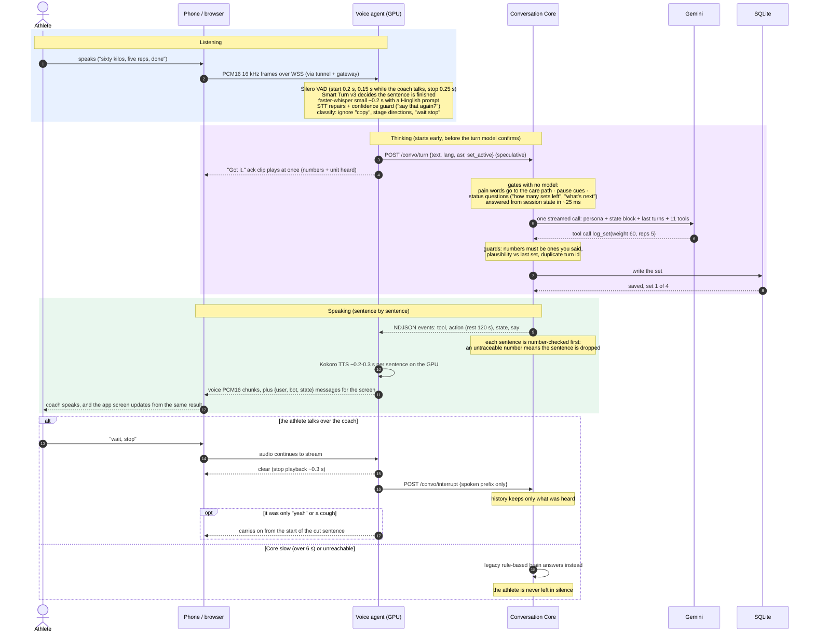
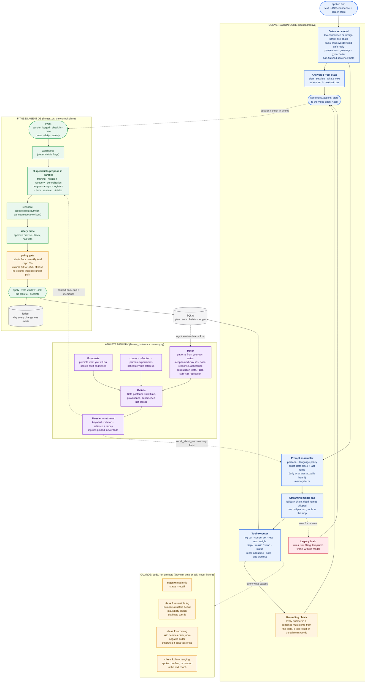

# AI Fitness Agentic System

A **voice-first, multi-agent gym coach** you talk to between sets. It logs your sets from speech, adapts your plan from your own data,
remembers what it learns about you, and sits behind a safety layer that can say no. Everything below was built from scratch in plain Python
and TypeScript: no agent framework, and no trained ML models. Numbers come from deterministic tools; language models only choose tools and word the reply.

| | |
|---|---|
| **Live voice coach** | Streams microphone audio to a GPU pipeline (VAD, turn detection, Whisper, Kokoro), answers sentence by sentence, can be interrupted |
| **Conversation Core** | One model call per turn with a small set of *guarded* tools, per-sentence number grounding, and a fallback brain that works with no model at all |
| **Agent OS** | Nine specialist agents, a safety critic with veto power and a policy gate, all with a ledger of why every change was made |
| **Athlete memory** | Beliefs with uncertainty, patterns validated with permutation tests, forecasts that score themselves |
| **Mobile app** | React Native (Expo) with a custom Kotlin audio module; also a voice page that runs in the phone's browser |
| **Hosting** | One isolated container per person on your own PC, a gateway, and a free tunnel |

---

## Architecture 1: the whole system

Where everything runs, and which way the data flows.

```mermaid
flowchart LR
  classDef phone fill:#e8f1ff,stroke:#2f6fed,color:#0b2a66,stroke-width:1.5px
  classDef edge fill:#fff4e0,stroke:#e08a00,color:#5a3600,stroke-width:1.5px
  classDef pc fill:#e9f7ee,stroke:#1f9d55,color:#0c3d22,stroke-width:1.5px
  classDef gpu fill:#f3e8ff,stroke:#8b3fe0,color:#3a1066,stroke-width:1.5px
  classDef cloud fill:#ffe8ec,stroke:#d6334d,color:#5c0f1d,stroke-width:1.5px
  classDef store fill:#f4f4f5,stroke:#71717a,color:#27272a,stroke-width:1.5px

  subgraph PHONE["PHONE"]
    direction TB
    APP["<b>React Native app</b> (Expo)<br/>Today · Live workout · Diet · Progress<br/>Insights · Coach chat · Roundtable<br/>Decisions · Trace · Knows-you"]:::phone
    NATIVE["<b>pcm-audio</b> native module (Kotlin)<br/>AudioRecord + echo cancel + noise suppress<br/>AudioTrack playback · 16 kHz PCM"]:::phone
    WEB["<b>Browser voice page</b><br/>/voice/web · Web Audio<br/>plays through earphones"]:::phone
    APP --- NATIVE
  end

  CF{{"<b>Cloudflare quick tunnel</b><br/>public https address<br/>(free, changes on restart)"}}:::edge

  subgraph PC["YOUR PC (Windows, Docker, RTX 3050 4 GB)"]
    direction TB
    GW["<b>Gateway</b> :8100 (FastAPI)<br/>Bearer key picks the person<br/>HTTP proxy · /voice/ws relay · /voice/web"]:::pc

    subgraph DOCKER["Docker: one isolated container per person"]
      direction TB
      BE["<b>Backend</b> :8001 (FastAPI)<br/>REST API · Conversation Core /convo/*<br/>live coach · diet · plan · insights"]:::pc
      AOS["<b>Fitness Agent OS</b><br/>specialists · critic · policy gate<br/>scheduler · memory layer"]:::pc
      DB[("<b>SQLite volume</b><br/>plan · sets · check-ins · meals<br/>memory · beliefs · ledger")]:::store
      BE --- AOS
      BE --- DB
      AOS --- DB
    end

    VA["<b>Voice agent</b> :8765 (Pipecat, GPU)<br/>Silero VAD · Smart Turn v3<br/>faster-whisper small · Kokoro TTS<br/>127.0.0.1 only"]:::gpu
  end

  GEM[/"<b>Gemini API</b><br/>3.5-flash-lite + fallback chain<br/>function calling · streaming"/]:::cloud

  subgraph SHIP["BUILD AND PUBLISH"]
    direction TB
    EAS["EAS Build<br/>Android APK"]:::store
    GH["GitHub repo + Actions<br/>Pages landing site"]:::store
  end

  APP == "HTTPS · REST + NDJSON stream" ==> CF
  NATIVE == "WSS · mic PCM16 up, voice PCM16 down" ==> CF
  WEB == "WSS · same protocol" ==> CF
  CF ==> GW
  GW == "HTTP by access key" ==> BE
  GW == "ws relay" ==> VA
  VA == "POST /convo/turn (NDJSON stream)<br/>POST /convo/interrupt" ==> BE
  BE == "HTTPS" ==> GEM
  AOS -. "wording only" .-> GEM
  EAS -. "installs" .-> APP
```



**Design choices that matter**

- **Per-person isolation.** Each person gets their own container, volume and API token. The gateway only routes; every container still checks its own token, so a gateway bug cannot cross users.
- **The voice agent holds no API key and no data.** It does audio only and talks to the person's backend over HTTP. The only things that leave the PC are text prompts to Gemini.
- **Graceful degradation everywhere.** No voice agent: the app falls back to the phone's own recogniser. No model: the Core hands the turn to the old rule-based brain. Dead model name: the fallback chain skips it.

---

## Architecture 2: one spoken turn, end to end

What happens between you finishing a sentence and the coach speaking, including interruptions.



**Measured on this PC** (synthetic speech through the real Whisper, Kokoro and Gemini; not yet verified on many real voices):

| Stage | Time |
|---|---|
| VAD stop → words (VAD + turn model + Whisper) | 0.25 to 0.35 s |
| Acknowledgement clip ("Got it.") | ~0.5 s after you stop |
| Session question (no model) | ~0.9 s to first sound |
| Set logged, composed reply (one model call) | ~1.0 s to first word |
| Model-decided turn (skip, chat) | 1.5 to 2.5 s |
| Barge-in: audio stops after you start talking | ~0.3 s |

---

## Architecture 3: the brain, the safety layer and the memory

How a reply is decided and kept safe, and how the system gets to know a person.



### What is enforced in code, not in prompts

- **Agent scope.** Nutrition cannot move a workout; the specialists only return typed proposals.
- **Safety limits.** Calorie floor, weekly load cap, volume band, no volume increase under pain or injury.
- **Numbers.** A reply can only contain numbers from the state, a tool result or your own words. The check runs on every sentence before it is spoken.
- **Skips.** "We are not skipping anything" never skips. A vague "let's move on" asks first. A skip naming an exercise that is not in today's plan skips nothing.
- **No silence.** If the model is slow or down, the rule-based brain answers.

---

## Results so far (be honest about what they mean)

| Test | Result |
|---|---|
| 259-scenario text replay: set-logging accuracy | **100%** (old rule-based brain 89%) |
| Self-corrections ("sixty... no, sixty-five") | **100%** (old 50%) |
| Asks instead of acting on ambiguous input | **100%** (old 50%) |
| Wrong actions on the 71 negative cases | **0** |
| English word error rate, audio replay | 2.0% |
| First composed word, median | 1.0 s |
| Test suites | 1,600+ tests (backend, agent OS, voice agent, app) |

All of this uses scripted and synthetic speech. The first real gym sessions found real bugs that the replay did not (several sets in one sentence, undo, logging an exercise
that is not in the plan, English mistaken for Hinglish). They are listed in `docs/ERROR_LEDGER.md` and are being fixed.

---

## Run it

**Backend (development)**
```
pip install -r requirements.txt
copy .env.example .env      # set GEMINI_API_KEY (logging, plans and review work offline without it)
python -m uvicorn backend.main:app --host 0.0.0.0 --port 8000
python -m pytest backend/tests fitness_os -q
```

**Mobile app**
```
cd mobile
copy .env.example .env      # EXPO_PUBLIC_API_URL = your PC's LAN address
npm start                   # Expo Go, typed input only; voice needs a development build (npx expo run:android)
```

**The full stack on your own PC** (Docker container per person + gateway + live voice agent + public address): double-click `START_COACH.bat`.
Setup is in `docs/LOCAL_HOST.md` and `docs/DEPLOY.md`; the voice agent (Python venv on the GPU) is in `voice_agent/README.md`.
`VOICE_BRAIN=legacy` before starting switches back to the old brain.

**Evaluate the voice coach** (throwaway backend, never touches real data)
```
python voice_agent/throwaway_backend.py
python -m voice_agent.eval run                 # text replay, scorecard + latency
python -m voice_agent.eval run ledger.yaml --mode audio   # real Whisper + Kokoro, timing, barge-in
```

## Repository map

| Path | What is in it |
|---|---|
| `backend/` | FastAPI app, live coach (`coach/`), Conversation Core (`convo/`), plan and adaptation policy (`policy/`), tools, SQLite access |
| `fitness_os/` | The Agent OS: agents, critic, policy gate, ledger, scheduler, memory layer (`mem/`) |
| `.claude/agents/`, `.claude/commands/` | The specialist agents as Claude Code subagents and the `/coach-event` loop |
| `voice_agent/` | The streaming voice agent (Pipecat), the replay harness (`eval/`), scenarios, the barge-in check |
| `mobile/` | Expo app, the Kotlin `pcm-audio` module, the app's voice client |
| `deploy/` | Per-person containers, gateway, start and stop scripts, the browser voice page |
| `site/` | Static landing page (GitHub Pages workflow in `.github/workflows/pages.yml`) |
| `docs/` | Plans, contracts, the error ledger, deployment notes |

## How adaptation works
`backend/policy/adaptation.py`: signal strength x confidence x change-dampening, with a small dead zone to avoid jitter. `POST /review` runs the agent debate; every applied change is written to the change log with reason and evidence.

## 12-week simulation
`python -m backend.sim.run` (about 3 min) runs the real agents against a simulated lifter (hidden strength and fatigue, noisy RPE) over 5 scenarios and compares each against a control where the plan never adapts.
The simulated lifter is a hand-written test dummy, not trained on real data, so it checks that the logic behaves as designed, not that it works for real people.

## Known limits
- The voice pipeline was measured on synthetic speech; real accents, gym noise and phone echo are only partly tested.
- Earphones: the Android app's own audio module forces the loudspeaker, so earphones need the browser voice page (`/voice/web`) until the next app build.
- The public address is a free quick tunnel and changes on every restart.
- Free-tier model quota and terms apply: on the unpaid tier, prompts may be reviewed by the provider, so do not send sensitive data.
